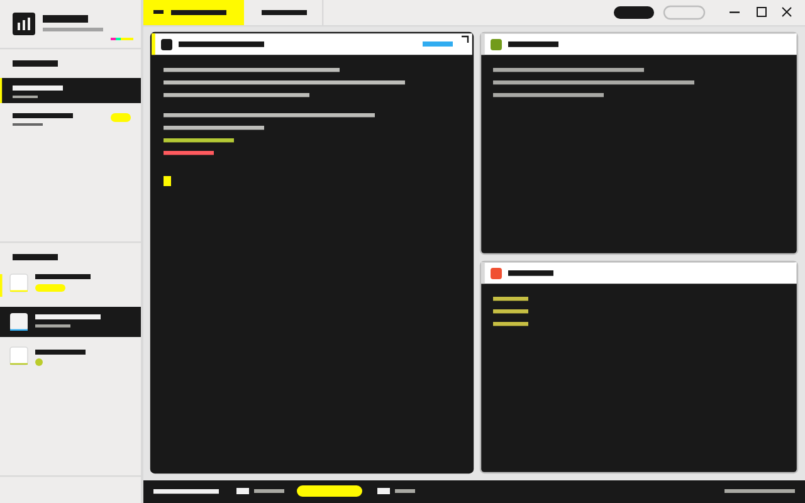

# Endfield for Herdr

A layout and theme for the [Herdr](https://herdr.dev) desktop app, styled after the wayfinding of a well-run factory. Paper chrome, ink terminal cards, and one acid yellow that means "you, here, now". Every agent's status is a word plus a glyph, and things move only where work happens.



> **Unofficial fan project.** Inspired by the visual language of Arknights: Endfield. Not affiliated with, endorsed by or sponsored by Hypergryph, Gryphline or the Herdr project. It contains no official art, logos or assets. See [THIRD_PARTY.md](THIRD_PARTY.md).

## What you get

- A sidebar with your spaces (repo, branch, ahead/behind) and your agents, each with its status, model, elapsed time and a context gauge. Sub-agents hang under their parent.
- A session card when you hover an agent: model, context use, tool calls, tokens, turns, its last action and any question it is waiting on.
- A tab strip with one sliding yellow block, ink pane cards with headers, an ink status bar with live counts, and toasts in the same style.
- Light (paper) and dark (night) appearances that follow your system.
- Claude Code sub-agent transcripts, readable in a pane with one click.

## Requirements

- The Herdr desktop app.
- [Node.js](https://nodejs.org) 18 or newer on your `PATH`. The install scripts need it, and so does the skin's session data: model, context and sub-agents for Claude Code. Without Node the layout still works and those fields read `—`.
- Optional: Python 3 with Pillow, only to build an art pack.

## Install

```sh
git clone https://github.com/<owner>/herdr-endfield
cd herdr-endfield
node scripts/install.mjs
```

Then switch layouts in Herdr with `ctrl-shift-l` until Endfield shows, or run `herdr-app do layout.switch --name endfield`.

The installer copies `skin/` into your Herdr home (`~/.config/herdr-app`, or `HERDR_APP_HOME` if you set it). It writes only files whose names start with `endfield`. If an Endfield file is already there, it backs it up first to `.endfield-install/backup/`. Running it again changes nothing.

To update, `git pull` and run `node scripts/install.mjs` again.

## Uninstall

```sh
herdr-app do layout.switch --name main
node scripts/uninstall.mjs
```

This removes what the installer added and restores anything it backed up. It leaves `data/endfield/` (cached session data and your operator settings) for you to delete by hand.

## Opt-in extras

Neither is installed by `install.mjs`. Each folder's README says what it changes and how to undo it.

- [`extras/claude-statusline/`](extras/claude-statusline/README.md): a Claude Code statusline in the same style. It also writes a small file per session, so the skin matches each agent to its exact session instead of guessing from the newest transcript.
- [`extras/powershell-prompt/`](extras/powershell-prompt/README.md): a one-line PowerShell prompt, `// folder  branch ›`, that also tells Herdr which folder you are in.

## Operator art

The skin can give each agent a character portrait. No art ships with it. [`art-pack/`](art-pack/README.md) builds a pack from images you supply and documents the format. Drawing the portraits on screen is on the [roadmap](ROADMAP.md); without a pack every agent keeps its program icon.

## Screenshots

<!-- Add screenshots of a demo session here: light, dark, the session card, a blocked agent. No personal folders or terminal contents. -->

Coming soon.

## More

- [RECIPE.md](RECIPE.md): the full design brief, region by region, in Herdr's recipe format.
- [CONTRIBUTING.md](CONTRIBUTING.md): the dev loop and the design rules.
- [ROADMAP.md](ROADMAP.md), [CHANGELOG.md](CHANGELOG.md).

Code is MIT-licensed. The bundled font is under the SIL Open Font License. See [LICENSE](LICENSE) and [THIRD_PARTY.md](THIRD_PARTY.md).
