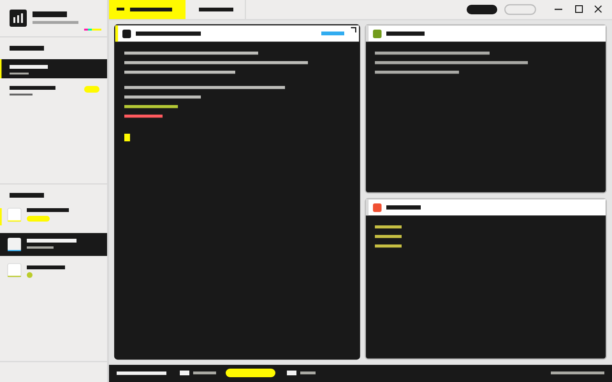

# Endfield

A Herdr layout styled as a well-run factory's wayfinding system. The chrome is
warm paper (`#EEEDEC`), terminals sit on ink cards (`#191919`), and one acid
yellow (`#FFFA00`) marks only what is yours right now: the active tab, the
selected space's edge, the focused pane, an agent that needs input, and primary
buttons. Status is always a word plus a glyph. Things move only where work
happens. A night appearance swaps the paper for near-black (`#141414` chrome,
`#0E0E0E` canvas) and keeps the rest.

`preview.png` is the layout's settings preview (`skin/layouts/endfield.svg`)
rendered at 4x. It is a schematic, not a screenshot.

## What you see

- **Sidebar, left, 248px** (min 44, max 480), paper ground with a 1px
  `#D9D9D9` divider.
  - Brand, 64px, drags the window: a 30px ink tile with three rising bars (click:
    command palette), "Herdr" in the wide face at 15px, the mono micro-label
    "Field ops", "Local" and "v<version>" 10px apart (the last two dimmer), and the window's only tri-colour bar
    (28x3px: `#FF1AAC` 5px, `#00FFA2` 5px, `#FFFA00` 18px) right-aligned 10px
    above the bottom hairline.
  - Spaces: header "// Spaces" (Geist 13 semibold), a mono count, a `+` and a
    `▾` chevron (`▸` when folded; not on the rail).
    Rows are 38px: `// name` (Geist 13 medium, the `//` muted) over a mono
    10px label (tab count, repo, branch, ↑ahead ↓behind). The selected row is
    inverted (ink, `#F2F2F2` text) in one frame; a 2px yellow marker travels
    to it (300ms). At the right:
    marching `▶▶` for working, a yellow block with an ink `!` for blocked, a lime disc
    with an ink ✓ plus an orange diamond for unseen done, nothing for idle.
    Machine groups (once a remote machine exists) get a wide-caps header, a
    hairline running to the right, a connection lamp and a chevron.
  - Squads: header "// Squads", mono `03/05 ACTIVE`, a `Priority ▾` pill
    (Priority or Tab order, within each squad). One squad per space, numbered
    like its space: a 22x16 ink number box, the space name in wide caps, a
    hairline, a yellow `!` box when someone needs input, the count, a round `+`
    (Dispatch a new agent there) and `▾`. Clicking the header folds it (rows
    close, 300ms) and a stack of its operators' 16px chips stands in for them.
    Agent rows, 56px (children 50px): a party chip (36px, children 28px: the
    operator's round portrait in a 2px white ring, yellow when it needs input,
    a 1px halo in the operator's accent, a class badge bottom right: `C`
    Claude Code, `X` Codex, `Cu` Cursor, `O` OpenCode, `G` Gemini); the
    label in wide caps 10px: an agent's program (`CLAUDE`, `CODEX`, `CURSOR`),
    a Claude Code sub-agent's type with any plugin prefix dropped
    (`POTETO-AGENT` for `pstack:poteto-agent`, `GENERAL-PURPOSE`, `EXPLORE`;
    `SUB-AGENT` when the transcript names none). Two sub-agent siblings
    with the same type and task are numbered `-2`, `-3` in start order;
    pane agents are never numbered (their task line comes from a tab name or
    a live title that changes), so the task tells them apart. The operator's callsign is on
    the session card, and the portrait is the operator. Then in mono the model and, 6px on in a dimmer grey,
    the effort level: `OPUS 5.5  MED` (effort reads LOW, MED, HIGH, XHIGH or
    MAX; left out for an agent with no Claude Code session; no
    terminal address, no tool count); at the right of that line a clock icon
    and how long the run has gone (to now while generating, else to its
    last write: `42s`, `27m`, `1h07`, `12h`, `3d`), then the status: "▶▶ Generating", two still bars and "Waiting", a
    yellow "Needs input" pill, "✓ Finished" or "× Error". The second line is the task
    (13px medium) with, at its right, an 8-block context gauge (5x6px blocks
    2px apart; lit share = used / window, red from 75%; its tooltip reads
    `157K / 1M, 16%`; an unknown window is 1M for a `[1m]` model or a
    context past 200K, else 200K). The status and elapsed never shrink; the
    model and effort give way first, then the label truncates. The label line
    and the task sit 2px apart (1px compact) and the row centres the pair, so
    the row's spare height falls above and below it, between one agent and
    the next. While a
    generating row under a minute is on screen the list redraws each second
    so its seconds count; otherwise every 30 seconds. While a Claude Code run
    has background tasks running, a stack glyph and their count (`3`, muted,
    tooltip "3 background tasks running") sit left of the clock; the model
    and effort give way to it. Sub-agent rows show the same. What isn't
    known is left out. Compact rows keep only the
    status glyph at the right. An idle
    row folds to one 34px line (26px compact): a 22px chip (18px compact),
    the label, the task at 11.5px and "zZ Idle". Blocked rows carry 4px hazard stripes on the left edge.
    Children (terminals started with `hc run`, and Claude Code's own
    sub-agents read from its transcript) hang under their parent with a 1px
    right angle from the parent chip's foot, whatever their vendor. Claude
    Code sub-agents show while working or waiting ("Waiting" beside two still
    bars in the working blue, no march), newest started first; right below them a
    26px row (22px compact) reads "▾ +N earlier" and lists the finished ones
    under it, newest first, or "▴ Show less" to fold them back, so folding
    never needs a scroll past the finished ones. Each parent keeps
    its choice until the mod reloads; there is no cap, the list scrolls. From 12
    agents everything goes compact: 34px rows, 24/20px chips, label over
    task, a status glyph only (`▶▶`, the still bars, `!`, `✓`, `×`, `zZ`); the spaces block becomes
    numbered squares, six a row; and a pinned "Needs input" box (hazard edge,
    count, three rows, then "+N more need input" left and "Report ▶" right) sits above every squad. The
    list scrolls and says "▾ N more agents below". Without the art pack every
    chip shows its program's tile instead.
  - Session panel, 368px, beside the sidebar while a squad row is hovered,
    laid out as a dossier. A header strip: the operator's bust in a dotted
    frame with a range ring and an accent foot, beside three lines. Line 1
    is the operator's callsign, the label its Squads row shows (`CLAUDE`,
    `poteto-agent`) and where it runs (`via <parent label>` first for a sub-agent, then the space and tab; `≈` when
    the transcript was matched by folder only), set apart by gaps, all but
    the callsign muted. Line 2 is the task in 15px semibold. Line 3 is the
    status glyph and word, then the model, effort (`med`) and elapsed time
    (`10m 16s`, to now while the run is in flight, else to its last write),
    muted. Then the body: Context (`Context`, the input tokens of the last
    request over the window in the wide face, `211K / 1M`, then `21%`, and
    20 full-width blocks, 10px tall, red past 75%); Tools (`Tools  64 calls
    Turns 12` and a hairline, then the four most called tools, each its name,
    an ink bar as long as its share of the first, and its count; an MCP tool
    by its own name, `save_issue`; "No tool calls yet." when none); Recent
    (the last five tool calls, newest first: age `18s` / `1m`, tool, and
    what it was asked, muted and truncated: a file's name, a command's first
    line, a pattern; "None yet." when none); Tasks,
    only once the session started background work (`Tasks 02`, a hairline,
    `+N finished` / `Show less` at the right; one 14px row per running task,
    newest started first: its kind glyph, a prompt for a shell, a figure for
    an agent, a pulse for a monitor, then its description and elapsed
    `42s` / `27m` / `1h07`, or "None running."; unfolded, the finished ones
    follow newest ended first, muted, with their end word `done`, `failed`
    (red), `killed`, `stopped`, `timed out` or `ended` and how long they
    ran; its own and its sub-agents' tasks together); Chat (its mode,
    then one pill per action: Claude Code Rename, Plan, Next
    mode, Model, Effort, Archive; Codex Rename, Model, Archive; Cursor Rename,
    Plan, Archive; typed ones dim with the reason when the agent isn't idle);
    Comms (the last two messages in and out, `Log ▶`); the question in
    brackets when blocked; an ink footer with Peek, Pin, Dispatch + and
    Answer/Focus ▶. Unknown
    fields (any non-Claude agent) read `—`. The panel draws at its own
    height up to the window's room; past it (a short window, a task list
    that grew or unfolded while open) the middle scrolls and the head and
    footer stay.
  - Action dialog, 560px, from a Chat pill: the field it needs (a name, a
    choice of models or levels), a Needs line (idle, or why not), a Does line
    (the side effect: `/model` and `/effort` also become your defaults for new
    sessions), and the graphite strip: a `Show command ▸` toggle (closed by
    default) that opens the exact lines Confirm runs, wrapped. After
    a send it reads back the model or effort (session data) or the mode
    (Claude Code's own line under its prompt), else says Sent.
  - Archived list, 600px, from Report's Archived pill: archived chats newest
    first, each with its folder, the exact argv Resume runs (programs.json
    `run` plus the resume arguments), a warning when it may reopen another
    chat, and **Resume** (dimmed while the chat still runs).
  - Footer, 40px: settings (with an orange diamond when an update is ready),
    add machine, fold sidebar, and the palette key in mono.
- **Tab strip, 36px**, drags the window: tabs run full height, separated by
  hairlines; each shows a mono index `01`, the agent icon, the label and its
  status. The active tab sits on a yellow plate that snaps to it while a 3px ink marker slides along its foot,
  with ink text and a close ×. Then an ink "+ New" button (radius 3, a 3px
  yellow tab on its left edge), the Files and Changes pills (ghost; ink when
  open; which show is shared `workspace.panels`), and on Windows and Linux
  44px minimise, maximise/restore and close buttons drawn as thin vector glyphs.
- **Work area**: 8px padding and 8px gaps on the canvas (`#E5E5E5`). Panes are
  ink cards, radius 4, 1px `#BDBDBD` border, `#191919` when focused, framed
  even when alone. A 34px white name plate: a 2px grey strip on its left edge
  that a 6px yellow bar grows down when focused (300ms), the program's 34px
  square tile (ink when focused), the operator's 22px chip on an agent's pane,
  the title in wide caps 12px, a mono line of the agent's label (as its Squads row reads), terminal, folder and branch 10px apart (the
  label muted, the rest dimmer; the chip's tooltip is the operator's callsign), the
  status at the right, and a 4px ink square in the top-right corner when
  focused. When that agent needs input while its pane has focus, the plate
  washes yellow and back (opacity 0 to .42, 1400ms), a 4px hazard rule runs
  under it and the pill turns ink with yellow text; no toast is made.
  Files and Changes open in a
  368px panel on the right (min 280, max 900), paper, radius 4.
- **Report**: the Report pill (ink, top right) swaps the work area for the
  oversight screen; the squad sidebar stays live beside it. A white panel with
  four corner brackets: `// Report` under `Oversight`, `every squad` and `last
  10 min` 10px apart (the last two dimmer) and a barcode; readouts with coloured left edges (Squads, Agents,
  Generating, Needs input, Finished, Tokens with a dimmer `10 min`); a pill
  with a muted `Group` and `Squad` (or None); sortable headings (Agent, Rate, Reserves, Turn, Status; the active
  one inverts to ink with ▼/▲; Status is the default: Needs input and Error, Finished,
  Waiting, Generating, Idle); squad headers like the sidebar's with `▶▶ n ✓ n` and a
  yellow `! n need input`, folding on click; rows with the chip and label,
  the terminal and its link (`◀ T3` and, 8px on, `Claude Code ▶ Cursor`, or `3 children`),
  a 16-bar output sparkline over 10 minutes (ink, never yellow), tokens a
  minute on a blue edge, context on a grey edge that turns red past 75%, the
  turn, and the status. Children stay under their parent whatever the sort.
  46px rows, 30px on one line past 12 agents; it scrolls. Output and rate exist
  for Claude Code agents only; others read `—`.
- **Dispatch**: a 660px paper dialog with two corner brackets, `// Dispatch`
  under the engine line (`hc send` then a dimmer `to a running agent`, or `hc run`
  then `new agent in a space`) and a barcode, a Send to agent / New agent switch and a round
  close. Send: target agents as party-chip tiles, each with its Squads label and address (yellow edge on the chosen
  one) and a line that says what hc will do for its status. New agent: program
  tiles on ink with a lime "installed" bar (not installed: dimmed), the
  operator it will be drawn as (automatic, by callsign), the squad (click for the next
  space) and the parent. For Claude Code in a folder on this machine it has
  not trusted yet (read from `~/.claude.json` by `tools/trust.mjs`, never
  written), a hairline `Trust` line: `First run in this repo: Claude Code
  will ask you to trust it once`. Then the task (or, for Shell, the command) in
  brackets: it wraps and grows from 2 to 6 lines; Enter adds a line and
  Ctrl+Enter (Cmd+Enter on macOS) dispatches, as the section's right label
  says. Then the delivery (Only if idle, Now, Now and wait for reply) or
  lifetime (Ends with parent, Outlives parent, No parent), and a graphite
  footer: `Current formula YOU ▶▶ CLAUDE T3` (the address
  dimmer, 6px on), under it a `Show command ▸` toggle (closed by default)
  that opens the exact hc command, wrapped, then Cancel
  and the yellow Dispatch pill. Opened from a squad header's `+`, the session
  panel's Dispatch, or the empty sidebar. Errors from hc show in the dialog.
- **Comms**: the Comms pill opens a pane beside the focused one: `// Comms`,
  All / You / Reports, a line naming its sources and what it can't see, and
  message cards (time and age, sender chip ▶▶ recipient chip, the text in
  brackets, the transport underneath, the left edge by kind: blue task or
  message, lime reply, yellow needs input, red exited). YOU is the only yellow
  chip; hc notes are a grey square.
- **HUD footer, 44px**: ink with a faint 45° grain. The number of active
  agents on a 22px odometer, `// space / tab`, then `▶▶ 14 GENERATING` and
  `✓ 01 FINISHED` on odometers; the account's Claude usage limits in the
  free width, each window a block of two rows on one left edge, `5-HOUR
  54% USED` over `▰▰▰▰▱▱▱▱ RESETS 1H 40M`, the percent column shared by both
  rows, the blocks 12px either side of a hairline, no dots or pipes (label
  and `USED` in the 10px mono label voice, the percent 13px bold; the kit's
  8-block gauge, filled by percent used; countdown `<1m`, `42m`, `5h 00m`,
  `2d 5h`; the newest any statusline sidecar carries; from 80% a red `▲`
  before the label, a red gauge and a red percent; a window whose reset time
  has passed reads `5-HOUR RESET` over an empty gauge; when the width runs
  short the gauges go first, then the second window's `USED`; the rows keep
  their 13px and 10px heights at every width; absent with no Claude
  statusline data; the countdown repaints once a minute); at the right the focused agent's context (used /
  total over a 3px bar, red past 75%), its model in white, then the branch and
  the machine in grey, 10px apart;
  and a 176px yellow block, `04 NEEDS INPUT ▶`, that opens (300ms) while
  anyone needs input; click goes to the first.
- **Toasts**: a white slab with a 3px edge and a round glyph in the level's
  colour, title, body, `// space` top right, a yellow "Open ▶" pill and a 2px
  countdown. An agent that finished gets the Finished slip: its chip flashes
  yellow once (.9 to 0, 300ms), the agent's label, a lime "Finished ✓" pill, the
  task, a "View ▶" pill, and `// space` and the terminal address 10px apart
  (the address dimmer).
- **Needs input, elsewhere: the cut-in.** A 440x214 ink slab at the bottom
  right, an overlay window (Herdr's toast slot is too small): a field of dots,
  a yellow diagonal band, the operator's signal duotone in a white frame with a
  yellow diamond above and a `!` badge, `// space` and `T3` 10px apart, a barcode, a white
  caption plate that a yellow block grows across (330ms), holds and retracts to
  a 4px edge (350ms, from 630ms), revealing "CLAUDE NEEDS INPUT" (the agent's label) in wide
  caps, a hazard rule, the question from its screen in brackets, and Answer ▶ /
  Later. It stays until answered or Later, and closes itself when the agent
  stops needing input or its pane gets focus.
- **Terminals**: JetBrains Mono 14 at weight 500 on `#191919`, foreground
  `#E6E6E1`, padding 14 by 10, yellow cursor, an original 16-colour set tuned
  to the status hues (working `#31ACF0`, blocked `#FFFA00`, done `#BBCC2B`,
  idle `#6E6E6E`).

## How it behaves

- **Generating:** `▶▶` steps through (300ms a beat) in flow blue. It is the only motion on a
  generating row.
- **Waiting:** two still bars in flow blue and "Waiting". Background work
  runs, but nothing on screen moves for it.
- **Needs input:** a yellow "Needs input" pill and a hazard tick, both still:
  blocked waits.
- **Finished:** the lime disc grows from 0 (200ms); it turns idle when looked at.
- **Error:** a red `×` and "Error", still.
- **Idle:** `zZ Idle` in muted text, still.
- **Start:** an ink screen with range rings and four registration crosses, a
  10px yellow bar fills the left edge (650ms from 100ms), `HERDR//` types on
  glyph by glyph (50ms apart from 200ms), a yellow rule retracts to the right
  (150ms from 760ms) under `// FIELD OPS` and `ESTABLISHING LINK` 10px apart, then the screen
  fades (225ms from 1275ms; a click skips it). The regions build in placeholder-first, each fading in (120ms) 100ms apart: brand, spaces and tabs,
  agents and panes, status. The mark's bars rise 80ms apart and the
  tri-colour bar wipes in.
- **Spaces:** click selects (the ink fill wipes in, the yellow edge grows
  down); drag reorders within a machine (a 2px line shows where); right-click
  opens the space menu; the machine header folds its group. The header's
  chevron (or the `endfield.toggleSpaces` key) folds Spaces to its 38px
  header with `layout.resize`, and Squads takes the height; unfolding
  restores the share it had. The fold is shared state, so it survives a
  restart.
- **Squads:** click focuses the pane (the plate snaps, the yellow marker
  travels, 300ms); a child without a pane opens as a peek; a Claude Code
  sub-agent opens its transcript beside its parent. A squad header folds it;
  dragging it reorders the squads within a machine (`space.move`). A drag
  starts only after 4px of travel. The held squad is lifted (raised plate,
  large shadow) and its top follows the pointer (60ms linear); the other
  squads slide (200ms) to open a gap where it would drop, which is the
  nearest slot on its machine below Pinned. Squads are drawn at computed
  tops, so the gap is a shift of tops, never a height change, and the
  selection marker rides with its row. On release the squad slides into the
  gap; Esc or the pointer leaving the list slides everything back. In Tab
  order a chat drags the same way within its squad (`tab.move`): it is
  grabbed by its first row, carries its children, sub-agents and "+N
  earlier", and is held as one lifted plate. Sub-agent rows and "+N
  earlier" don't drag. In Priority the sort decides the order, so a chat
  doesn't drag and the sort pill's tooltip says to switch to Tab order. No
  session card opens while something is held. A double-click on a squad's
  name (which never folds) edits the name in place
  (`space.rename` on Enter). Right-click on a squad header opens a popup
  menu: Rename squad, Move up, Move down. Right-click on an agent or
  sub-agent row holds its session card open. Nothing moves a chat to
  another squad: Herdr has no cross-space tab move, and relabelling a live
  terminal's `herdr.space`/`herdr.tab` (`hc label`) leaves its pane where it
  is (measured on one throwaway terminal: new space alone, new space and tab,
  and labels removed all kept it in its first tab).
  In Priority, an agent row drags onto another to link it as a helper
  (`links.js`): it stays in place at 45% opacity, a ghost plate (raised,
  large shadow) follows the pointer and names the row under it, and that row
  gets a 1px border, `text` when a drop links there, `hairStrong` with the
  ghost saying why when it can't (`linkProblem`: both Claude Code, one
  machine, one space, the helper with no hc parent or lead, no cycle, both
  sessions read). The row under the pointer is the one the pointer itself
  is over: the press records how far into its row it landed. Nothing slides.
  Release on a valid row opens Link as helper; anywhere else does nothing.
  A linked helper sits under its lead with the connector and a `linked` micro
  tag after its label; its hc parent, the Report tree and hc's parent notes
  are untouched. The link drops when either terminal ends, when either
  shell runs a new Claude Code session or another program (the link keeps
  both session ids), or when the two sit in different spaces (Herdr can't
  move a chat between spaces, so such a link is never drawn).
  The sort pill opens Priority or Tab order. A new child draws its connector
  top-down (240ms); a newly pinned agent fades in. `alt-up` /
  `alt-down` follow the list's order.
- **Session card:** after 250ms on an agent or sub-agent row it fades in and
  slides 16px right (300ms) and the context blocks light 18ms apart. Moving
  onto the card keeps it; leaving both closes it after 160ms. A press outside
  the card closes it at once, except on its own row. A hover-out Herdr never
  reports closes nothing until the next press: the pointer's position is not
  read. A right-click on the row opens the card at once and holds it: hover
  no longer closes it, and it goes on a press outside it (its own row too) or
  Esc. A held card that was already up is replaced with no reveal.
  Its top sits 12px above its row's, or as far up as keeps it 8px inside the
  window. In a window too short for it the head and the ink footer stay and
  the middle scrolls, never under 120px. The window's height is its viewport
  divided by the zoom; when it changes while the card is open, the card is
  placed again 160ms later with no reveal.
  Answer/Focus runs
  `agent.focus`, Peek `terminal.peek`, Pin `terminal.pin`.
- **Sub-agent card:** the same dossier for a Claude Code sub-agent, headed
  by its own operator's callsign, its type and `via <parent label>`: the same header
  strip, Context, Tools, Recent and Tasks, read from its own transcript. It has
  no Chat row, no Comms and no Peek, Pin or Dispatch. Open transcript opens
  the transcript pane as a click on the row does; Follow-up opens it with the
  follow-up box focused 300ms later. Nothing is sent from the card.
- **Chat actions:** a Chat pill closes the card and opens its dialog; nothing
  runs from the pill. Confirm runs the shown lines once: typed text as
  `hc send <t> --if idle -- "<text>"` (never `--force`), Next mode as
  `hc keys <t> shift+tab` only if Herdr still says idle at the click, Rename
  as `tab.rename` (plus `/rename <name>` when ticked). A `done` agent counts
  as not idle: Peek or Focus it first. Each send is logged to Comms as an
  Action. Archive types `/exit` (Claude Code) or `/quit` (Codex, Cursor),
  records the chat in `data/endfield/archive.json` and keeps the terminal out
  of Squads (`endfield.archived`). Resume runs `tab.new {name, space, folder,
  argv}` with the program's `run` argv plus `--resume <id>` (Claude Code),
  `resume --last` (Codex) or `resume` (Cursor), and drops the record.
  The dimming and every send gate on Herdr's own status, so an agent that
  reads Waiting but Herdr calls idle takes typed actions.
- **Link as helper:** the dialog names the lead and the helper, says
  whether both are idle, and lists the two lines Confirm runs:
  `hc send <lead> --if idle -- "<note>"` then the same into the helper.
  Confirm first writes `{a, b, sa, sb, at, noted}` (lives,
  `address@created`, their session ids, and `noted: {lead, helper}`, whose
  note was typed) to `data/endfield/links.json` (read again just before the
  write, expected-snapshot write, one re-read retry). A helper the file
  already gives another lead, linked from another window, is refused with
  that reason, never moved. Then it types the lead's note, then the
  helper's, noting each one sent. Either one not idle refuses before
  anything is written. A refused lead takes the link back out; a refused
  helper keeps it, and Confirm again types only the helper's note. Closed
  before that, the helper's card offers **Send note again** while its note
  is unsent, which opens the same dialog at the helper's note alone
  (`{from: 1}`). Each note names the other by folder, terminal and task
  (the label its row shows), and asks them to
  coordinate through Claude Code's cross-session messaging (`ListAgents`,
  `SendMessage`, `notify_when_idle`; see
  https://code.claude.com/docs/en/cross-session-messaging.md) and to agree
  file ownership or use separate worktrees; `hc read` is the fallback for
  watching the other's screen. The dialog notes that a `--bare` session
  can't receive messages and that `crossSessionInbound` can refuse or hold
  them. The helper's card shows **Linked**, its lead and **Unlink**, which
  rewrites the file and types nothing; the lead's card lists its helpers.
- **Claude Code agent waiting on background work:** when Herdr says idle or
  done but the session's turn ended (or it sits in a wait) with a
  background shell, agent, monitor or sub-agent still running, the agent
  reads Waiting (two still bars) everywhere its status shows: Squads, the
  pane plate, the Report and the session panel. It counts as neither
  Finished nor Idle in the HUD footer and the Report, and sorts below
  Finished and above Generating (`STATUS.waiting.rank`), as agent.next does. One
  place decides it (`fleet.js memberStatus`, fed by the session poller's
  `endfield.waiting`). The Finished slip still follows Herdr's done.
- **Claude Code sub-agent row:** read from its transcript, not from how long
  ago it wrote. Working while a tool call has no result or its turn has not
  ended. Waiting when that tool call only waits (a shell that sleeps, loops
  or reads a background task's output), or when its turn has ended with a
  background shell, agent or monitor it started still running. Else done,
  or idle once its parent is idle. A turn ends with a last message, a
  handback or an interrupt. A foreground shell call quiet past its own
  time limit (its timeout, else 2 minutes, at most 10) is over. Once the session's Claude Code process has
  exited, every sub-agent is done. Click opens its transcript
  read-only in a pane right of the parent: the prompt on a
  yellow edge, the assistant's words as markdown, each tool call as
  `● Tool arg` with its result folded to its first line. It follows the
  file and keeps the newest entry in view. A tab has one transcript pane:
  clicking another sub-agent replaces it, clicking the one shown focuses it.
  The shown sub-agent's row wears the selected plate, and the yellow marker
  while its pane has focus. The pane's foot is a follow-up box on a raised
  ground: `// FOLLOW-UP` and `SENT VIA CLAUDE, WHO PASSES IT ON WITH
  SENDMESSAGE`, a one-line input and a round Send button, then a `Show
  command ▸` toggle (closed by default) that opens the exact `hc send` command
  in mono, wrapped. The sub-agent has no terminal, so the text
  goes to its parent, asking it to forward the text with SendMessage. Send is
  yellow only while it would go and the input has focus; otherwise outlined,
  and dimmed with the reason in place of the toggle when the parent is
  working, needs input or is gone. Enter sends too. Nothing sends otherwise.
- **Tabs:** click selects (the yellow block slides over left and width,
  300ms), double-click renames, drag reorders, right-click opens the tab menu,
  the wheel switches tabs. Hover grows a 24px, 2px underline from the left.
  Close buttons grow a red disc behind the ×.
- **Ink buttons:** on hover the yellow side tab fades as a yellow ▶ fades in
  and slides from 2px to 9px, and the label slides 5px right (200ms).
- **Footer:** round icon buttons fill signal yellow on hover (a disc grows from
  the centre) and the glyph turns ink.
- **Rows** (spaces, agents, sub-agents): hover wipes a sunken layer in and
  slides the label 4px right; an agent tile's status bar grows from 2px to 4px.
- **Pane header:** click focuses; on focus the yellow tab grows and the
  bracket drops in; on hover a tray opens with split right, split down, zoom
  and close fading in 40ms apart.
- **Status bar:** counts roll like an odometer. The palette hint and the brand
  mark open the command palette.
- **Folded sidebar** (below 160px): numbered 28px squares in the wide face
  (the selected one inverted with a yellow edge, a status bar along each
  bottom) and an agents rail with `»` to unfold.

## Built from

- `layouts/endfield.json`: root row, `titlebar: "none"`, `traffic_lights:
  [12, 16]`, theme `{light: "endfield", dark: "endfield-night"}`, font
  JetBrains Mono 14/500, `ui_font` Geist, `terminal_padding: [14, 10]`,
  `toast: "endfield"` (the mod's `toast` role), `preview: "layouts/endfield.svg"`.
  - `sidebar` (column, 248px, min 44, max 480, chrome): `brand` (64px,
    `window_drag`), `sidebar-lists` (`spaces` weight 1, `agents` weight 1.2,
    min 38 and 90: `spaces` folds to its 38px header), `sidebar-footer` (40px).
  - `work` (column, canvas): `tabs` (36px, `window_drag`), `work-body` (row,
    padding 8, gap 8: the `work-stack` stack, whose children are `main` with
    the pane frame and `report` (role `report`), and the hidden `panel`, 368px,
    holding the `panel-body` stack of the shipped `files` and `changes`),
    `status` (44px).
  - Every chrome block is `{mod: "endfield", props: {role}}`. The pane frame:
    background `#191919`, border 1 `input`, focus 1 `solid`, radius 4, gap 8,
    `lone: true`, header `{mod: "endfield", props: {role: "pane"}}`, 34px,
    top, always.
- `themes/endfield.json` and `themes/endfield-night.json`: terminal colours
  plus every panel colour by name.
- `mods/endfield`: one mod in roles, routed by `ROLES` in `main.js` (`boot`,
  `brand`, `footer`, `spaces`, `agents`, `sortmenu`, `squadmenu`, `card`, `tabs`, `pane`,
  `status`, `toast`, `cutin`, `report`, `dispatch`, `comms`, `transcript`,
  `action`, `archived`). `kit.js` holds the tables every role reads: `PALETTE` (`paper`
  and `night`), `STATUS` (word, glyph, colour, entrance, rank per agent
  status), `IDENTITY` (who an agent is drawn as) and `MOTION` (every timing).
  An agent with a known model is drawn from its model's tier: `CASTING` in
  `fleet.js` maps the model id to fable, opus, sonnet or haiku, and each tier
  has a pool of operators, strongest first (docs/CASTING.md). Siblings draw
  different operators; a callsign is numbered (`YVONNE-2`) only once its pool
  is spent. An unknown model draws the Endministrator.
  Behaviour is adapted from Herdr's shipped `spaces`, `agents`, `tabs`, `pane`,
  `workspace-chrome`, `workspace-status` and `toast` mods.
- Notifications: the layout's `toast` is the `endfield` mod; Herdr opens it with
  notification props and no role, and `main.js` routes those to `toast`.
- The transcript pane is the `endfield` mod's `transcript` role, props
  `{role: "transcript", path, title, id, parent, via}` (the sub-agent's id,
  its parent's terminal and label). It runs `hc send` to the parent
  (`orders.js` `relayOrder`), reads `agents()` for the parent's status, and
  appends to `data/endfield/comms.jsonl`. `panes()` doesn't report a mod
  pane's props, so the shared key `endfield.panes` records which endfield
  pane is Comms and which a transcript (`fleet.js` `paneRole`).
- The session card is the `endfield` mod as an overlay with `frame: "none"`:
  `kind: "window"` while hovered, `kind: "popup"` when a right-click holds it
  (Herdr closes a popup on Esc and on a press beside it). Props `{role:
  "card", terminal, sub, title, where, ident, snap, fit, shown, held}`; `sub`
  is a sub-agent's id and `terminal` then its parent's. Shared keys:
  `endfield.card.open` (the one card the agents list owns),
  `endfield.card.hot` (the pointer is on the card),
  `endfield.card.closed` (the overlay id of a card pressed beside, or closed
  by itself; a press on a hovered card's own row is not a dismissal),
  `endfield.card.ask` (`{key, act, at}`: a sub-agent card's button asks the
  list to open the transcript pane), `endfield.followup` (`{path, at}`: the
  transcript pane showing `path` focuses its follow-up box),
  `endfield.identity` (the identity table changed), `endfield.models` (each
  Claude Code agent's model id, for casting), `endfield.archived` (Hides,
  `{life: "address@created", program}`, of archived chats' leftover shells,
  kept out of every roster while no agent runs there), `endfield.links`
  (Links, `{a, b, sa, sb, at, noted}`, as links.json was last read: the
  Squads list reads it again every 5s, so another window's links show;
  every roster nests helpers by it), `endfield.sessionIds` (each Claude
  Code agent's session id, which a link is kept to), `endfield.rowTitles`
  (each agent row's task label, which a link's note quotes).
- A card action's dialog is `{role: "action", terminal, action, snap}`, a
  dialog with `frame: "none"`; the archived list is `{role: "archived"}`;
  Link as helper is `{role: "link", lead, helper, from}` (`from: 1` types
  only the helper's note).
  The actions are data: `ACTIONS[programKey]` in `orders.js`.
- `herdr` calls: `spaces`, `agents`, `terminals`, `panes`, `focused`,
  `machines`, `layout`, `settings`, `keys`, `updates`, `fonts`, `shared`,
  `setShared`, `setAgentOrder`, `openOverlay`, `closeOverlay`, `run`, `exec`,
  `hc`, `watchFolder`, `readTextFile`, `writeTextFile`, `knownAgents`,
  `fs/promises`.
- Programs it runs: `git` (branch, ahead/behind, changes), `hc` (machine list,
  reconnect, Dispatch and card actions), and `node
  mods/endfield/tools/probe.mjs` (reads transcripts).
- Files it reads outside its folder: Claude Code transcripts under
  `~/.claude/projects/`; optional statusline sidecars in
  `data/endfield/sessions/<session_id>.json`; optional
  `art/operators/manifest.json` and `data/endfield/operators.json`. It writes
  only under `data/endfield/` (the probe's cache and request files, the Comms
  log, `archive.json`, `links.json`).
- Commands: `space.select/move/new/rename`, `agent.focus`, `tab.new/select/move/rename/close`,
  `pane.focus/split/zoom/close`, `terminal.pin/peek`,
  `layout.resize/show/hide/select`, `app.palette`, `app.settings`, `mod.open`,
  `window.minimize/maximize/close`.
- Shipped overlays reused: `menu`, `new-menu`, `files`, `changes`, `picker`,
  `machine-add`, `worktree`.
- Art: every SVG in `mods/endfield/art/` is original, written by
  `tools/make_art.py`. The wide face is Saira (OFL) instanced to
  `fonts/EndfieldWide.ttf`. No character art ships; an optional art pack is
  built from the person's own images (`art-pack/`).

## Watch out

- Windows registers the font family "Endfield Wide" as "Endfield"; look the
  name up with `fonts()`.
- Theme `background` and `foreground` are the terminals' and also the shipped
  Files and Changes panels'. So the overlay colours (popover, raised,
  foreground) are ink-side in both appearances, and only `chrome`, `canvas`,
  `border` and `input` are paper.
- The focused pane border uses the theme's `solid` (ink on paper, paper at
  night).
- Mods have no colour transition: hover and selection fills are absolute
  layers whose width transitions, measured from each list's `on_size_change`.
- Selection blocks need fixed row heights (spaces 38, machine header 28,
  login guidance 48, notes 30; agents 56, children 50, idle rows 34,
  sub-agent toggle 26, squad header 28; compact 34, 34, 26, 22, 26).
- Flicker is a `.loop("opacity")` that a one-shot timer removes after three
  pulses. No repeating timer drives motion; the repeating timers are for data
  only (30s age labels, a one-second redraw while a generating row is under a
  minute old, the session card's one-second task clock, the footer's
  one-minute reset countdown, git and machine checks, Comms' screen scan, and
  a 3s session poll that runs only after `watchFolder` reports a change).
- Herdr docks a mod folder into the shown layout the moment it sees one
  without a `mod.json`: write `mod.json` (`"place": "none"`) first.
- A window overlay's id isn't visible from outside and `overlay.close`
  without one doesn't close it: a card left behind by a hot reload closes
  itself because `endfield.card.open` no longer names it.
- `openOverlay` `at` and mouse `bounds` are logical px; `herdr-app shot` is
  physical.
- Transcripts reach tens of MB and `readTextFile` stops at 1 MiB, so a node
  script reads them, folding each file once and caching the fold and byte
  offset. Claude Code writes an assistant message as one line per content
  block, each repeating the usage, so usage counts once per message id.
  Context used = input + cache creation + cache read of the latest message.
  Without `node` on PATH the session fields read `—`.
- Without a statusline sidecar, a terminal is matched to the newest
  transcript in its folder; two sessions in one folder can't be told apart,
  and the card marks it `≈`.
- The toast's countdown doesn't pause on hover: the host closes a toast at
  its `timeout` whatever the mod draws.
- Hover effects need a pointer; `herdr-app shot` can't show them.
- Assumes Herdr's shipped `files`, `changes`, `menu`, `new-menu`, `picker`,
  `machine-add` and `worktree` mods exist.

## Done when

- `herdr-app check` passes on `mods/endfield`, there is no `*.error` file,
  and `herdr-app status` lists no errors (`node scripts/verify.mjs` runs all of these).
- `herdr-app do layout.switch --name endfield` shows the boot, then every
  region, in light and in dark appearance.
- With two spaces, two tabs, a split and an agent reporting `blocked`, the
  sidebar, tab strip and status bar show it as described; `layout.resize
  {id: "sidebar", px: 44}` shows the rail.
- An agent reaching `done` in a tab you aren't looking at posts a toast with
  a lime edge.
- `pane.split {direction: "right", pane, mod: "endfield", props: {role:
  "transcript", path}}` on a sub-agent transcript shows its entries and grows as the file
  does. Opened from Squads, its foot shows the `hc send` to the parent for
  the typed text, and Send is disabled with a reason while the parent works.
- With `art/operators/` deleted, every surface still draws, with program
  tiles.
